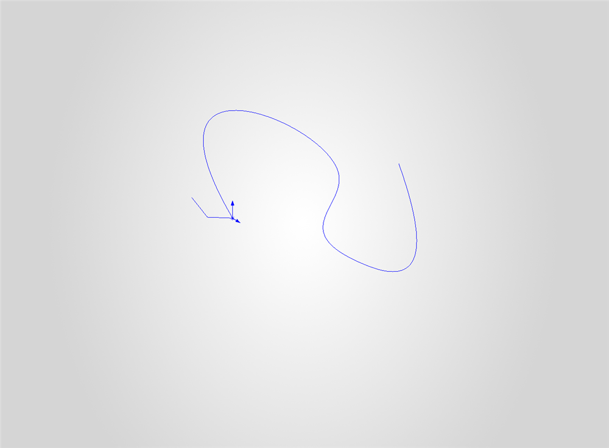
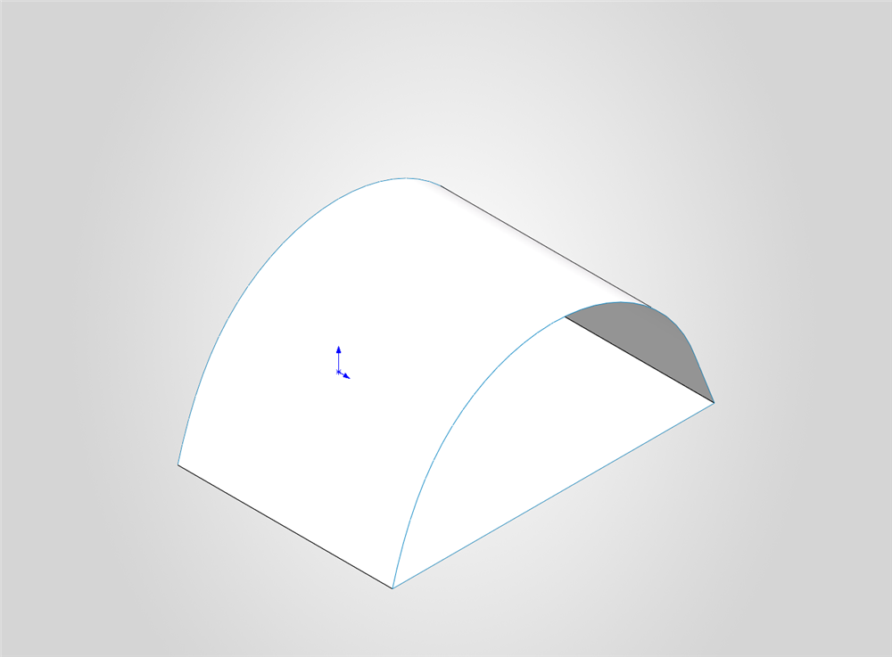
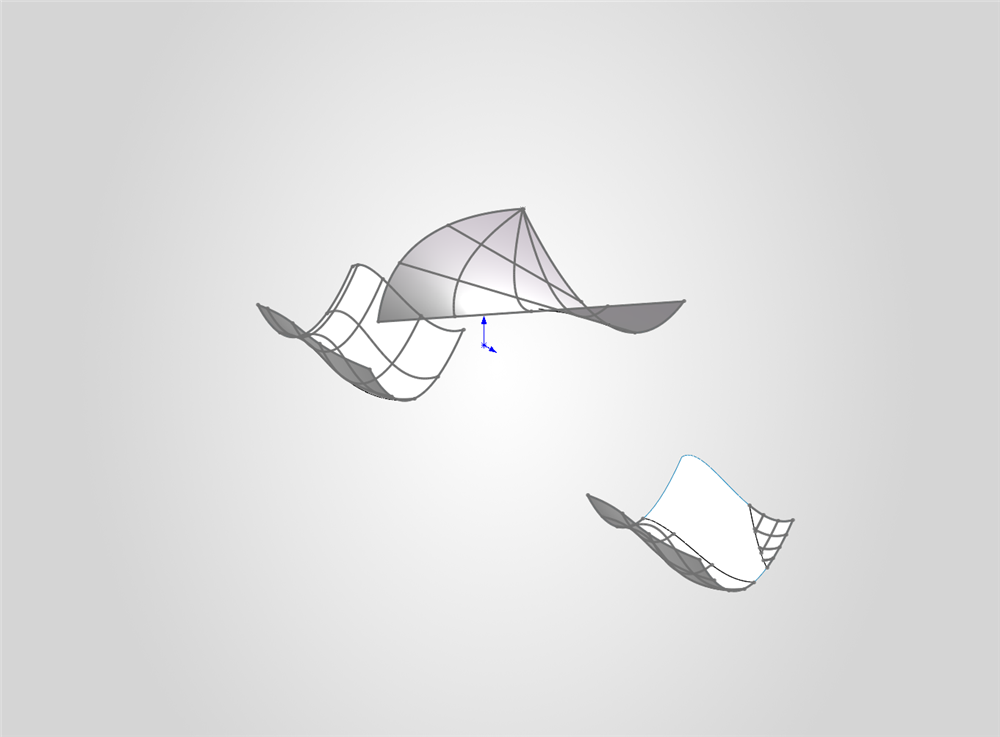
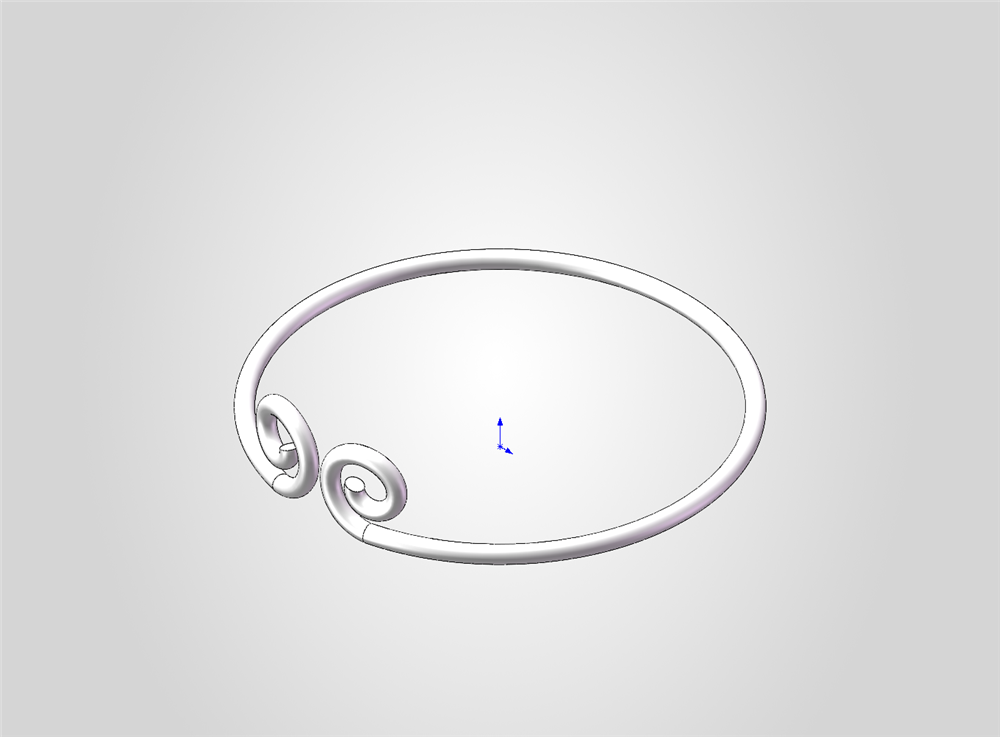
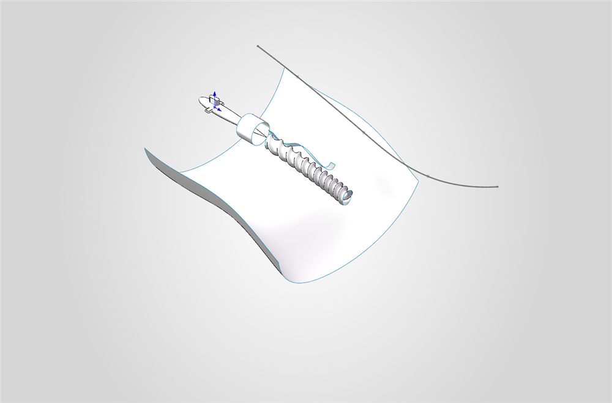
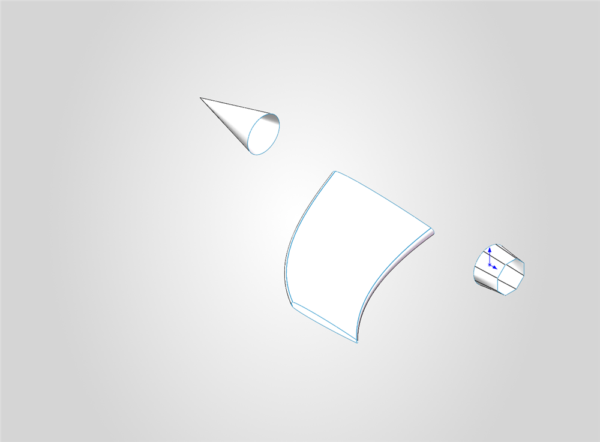
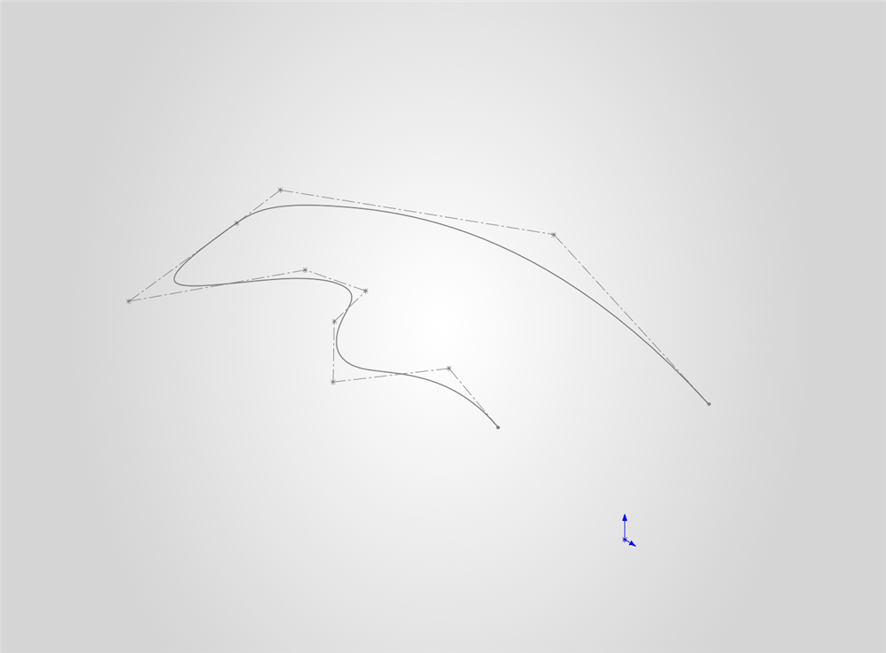
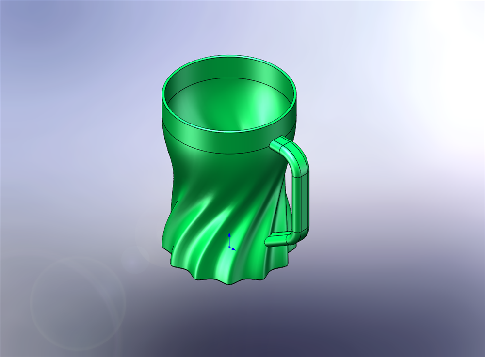
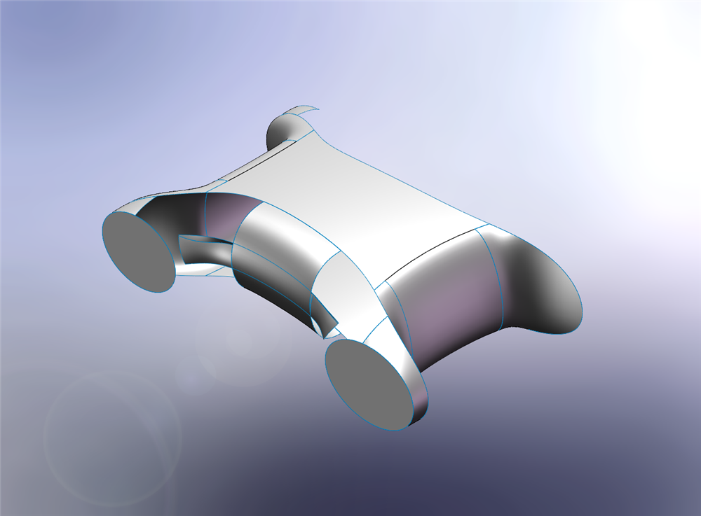
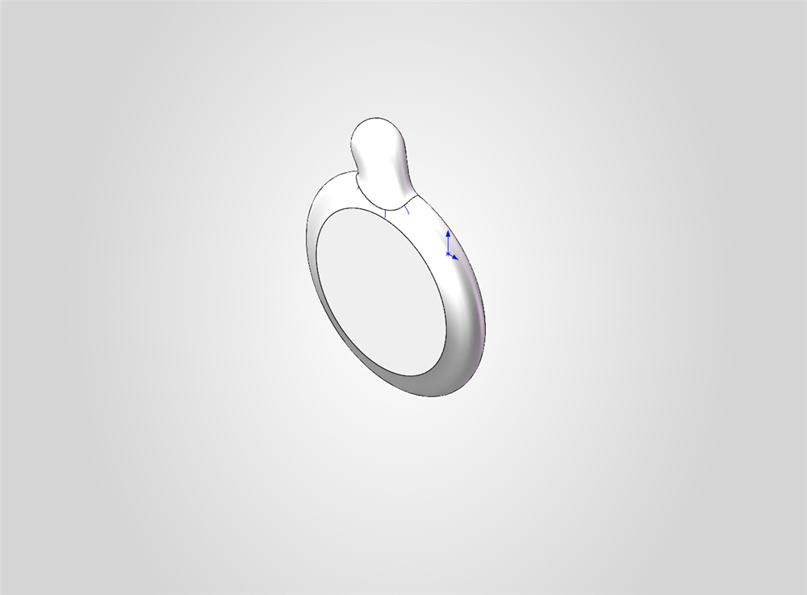

# curved-surface — 曲面建模练习

> ✅ **已完成** — 基础练习与实战案例均已建模完毕。

曲面建模专项练习集，分两部分：

- **基础篇**（`quminajichu/`）—— 由易到难的曲面特征练习：组合曲线 → 曲面拉伸 → 扫描 → 放样 → 旋转 → 分割线 → 镜向
- **实战篇** —— 综合运用：扭曲杯（实体化）与麦轮小车（曲面车身）

**建模环境**：SOLIDWORKS 2026 ｜ **时间跨度**：2026-07 ~ 2026-08

---

## 一、基础练习

| 文件 | 预览 | 主要曲面特征 | 几何体 | 包围盒 (mm) | 特征数 |
|---|---|---|---|---|---|
| `quminajichu/3.SLDPRT` |  | `3D草图1` + `组合曲线1` | 曲线（无体） | — | 19 |
| `quminajichu/04.SLDPRT` |  | `草图1` + `曲面-拉伸1` | 1 曲面体 | 10 × 8.5 × 15 | 19 |
| `quminajichu/5.SLDPRT` |  | `曲面-扫描2`、`分割线1`、`曲面-放样1` | 3 曲面体 | 730.7 × 349.3 × 240 | 29 |
| `quminajichu/6.SLDPRT` |  | `螺旋线/涡状线1`、`曲面-拉伸`、`组合曲线2`、`扫描4`、`镜向1` | 1 实体 | 52.4 × 11.2 × 52.1 | 33 |
| `quminajichu/7.SLDPRT` |  | `曲面-旋转1/2`、`曲面-扫描1/4`、`曲面-拉伸1~3`、`分割线1` | 1 实体 + 6 曲面体 | 1084.5 × 652.3 × 940.9 | 36 |
| `quminajichu/8.SLDPRT` |  | `曲面-放样1/3/7/8`、`曲面-旋转1`、`镜向1` | 6 曲面体 | 1169.3 × 120 × 560 | 49 |
| `quminajichu/零件1.SLDPRT` |  | `草图1`（样条骨架） | 草图（未成体） | — | 18 |

> 特征数为 SolidWorks 特征树节点总数，含基准面、材质等系统项。

**练习脉络**：`3` 用 3D 草图与组合曲线搭出空间骨架；`04` 是最小单位的曲面拉伸；`5` 把扫描曲面与放样曲面拼在一起；`6` 引入螺旋线/涡状线并配合镜向；`7`、`8` 则是多段旋转、扫描、放样的复合曲面，需要反复分割与拼接才能收出连续过渡。

---

## 二、实战案例

### 扭曲杯 `quminajichu/杯子.SLDPRT`

一个**花瓶式扭曲杯**，桶身带螺旋扭曲曲面，底部为波浪形裙边，侧面有独立建模的提手。

| 项目 | 值 |
|---|---|
| 尺寸 | 130 × 141.7 × 102.1 mm |
| 类型 | **实体**（曲面已加厚） |
| 特征数 | 36 |

关键特征链：`曲面-拉伸1/2` → `曲面-放样2` → `曲面-缝合1` → **`加厚1`** → `扫描1`（提手）→ `分割3` → `组合1` → `圆角1/2`

> 这是全套练习里唯一走完「曲面缝合 → 加厚成实体」完整流程的零件。

### 麦轮小车

| 文件 | 预览 | 说明 | 几何体 | 包围盒 (mm) | 特征数 |
|---|---|---|---|---|---|
| `quminajichu/麦轮小车/1.SLDPRT` |  | 车身外形，流线型曲面 | 8 曲面体 | 209.3 × 68.3 × 154.7 | 132 |
| `quminajichu/麦轮小车/麦轮.SLDPRT` |  | 麦克纳姆轮辊子 | 3 曲面体 | 58.5 × 69.4 × 19.3 | 45 |

**车身**（`1.SLDPRT`，132 个特征，是本项目最复杂的零件）
命名草图可见清晰的设计意图：`车身上视轮廓` → `前视图内部结构` → `旋转1` → `镜向4/5` → `电机底座草图` → `放样1` → `曲面-等距1` → `前方切割线` / `后方切割线` / `车身切割线` → `分割1` → `圆角1~4`。
思路是「先定轮廓与内部结构，再用多条切割线分割曲面，最后圆角收面」。

**麦轮**（`麦轮.SLDPRT`）
`旋转1` → `阵列(圆周)1` → `曲面-旋转1/2` → `曲面-剪裁1` → `曲面-等距1/2` → `圆角1`，用圆周阵列生成辊子排布。

> ⚠️ 车身与麦轮目前均为**曲面模型，未缝合为实体**。若要做仿真或出图，需先补 `曲面-缝合` + `加厚/加厚切除`。

---

## 三、无实体文件说明

以下 5 个文件经 SolidWorks 扫描确认**不含实体、也不含曲面体**（`GetBodies2` 返回 0）。
其中 3 个是彻底的空文件，另 2 个只留有草图/曲线，属于练习过程中的中间产物：

| 文件 | 内容 | 说明 |
|---|---|---|
| `1.SLDPRT` | 无任何特征 | **空文件**，只有基准面与原点 |
| `quminajichu/2.SLDPRT` | 无任何特征 | **空文件** |
| `quminajichu/刀子.SLDPRT` | 无任何特征 | **空文件**（原计划建模刀具，未实施） |
| `quminajichu/3.SLDPRT` | `3D草图1`、`组合曲线1` | 只有空间曲线，未生成曲面 |
| `quminajichu/零件1.SLDPRT` | `草图1` | 只有平面草图（样条骨架） |

> 除 `1.SLDPRT`、`2.SLDPRT` 外，其余三个仍保留了建模过程，建议保留存档。

---

## 四、使用提示

- 各文件均为**独立零件**，互不引用，可单独打开
- 曲面练习中的 `分割线`、`组合曲线` 等特征依赖草图基准面关系，**不要单独移动文件路径**，否则引用可能失效
- `.SLDPRT` 在 GitHub 上**无法在线预览**，本目录的 `preview/` 即为此准备的离线预览图
