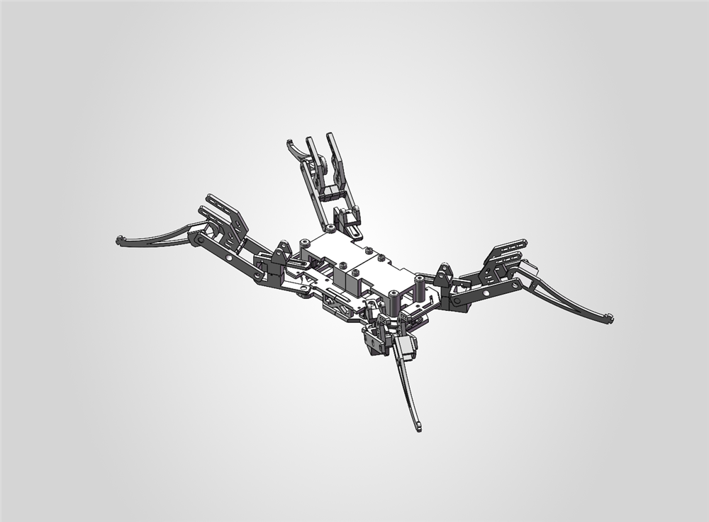
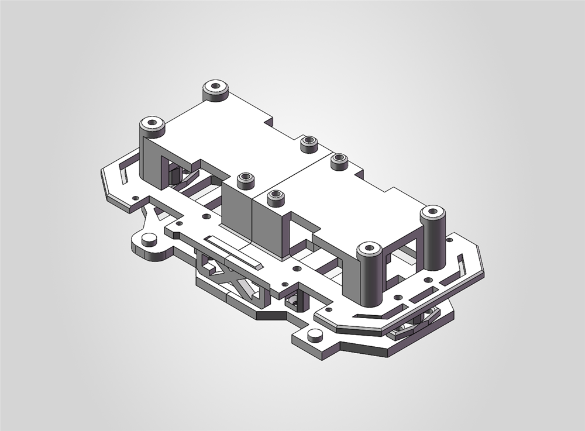
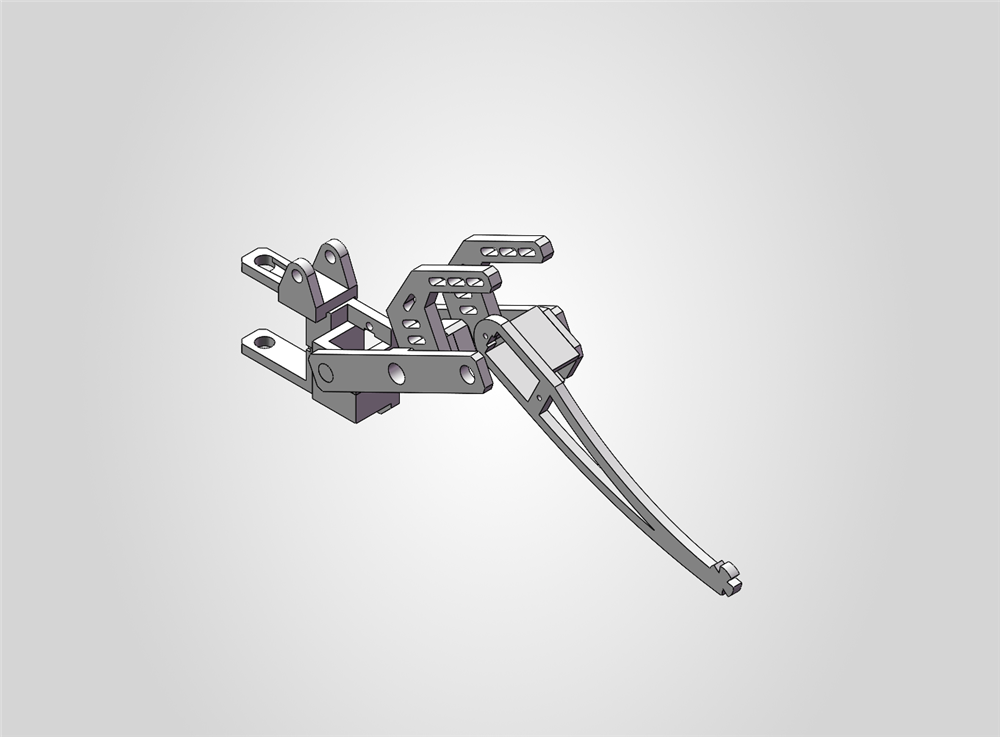
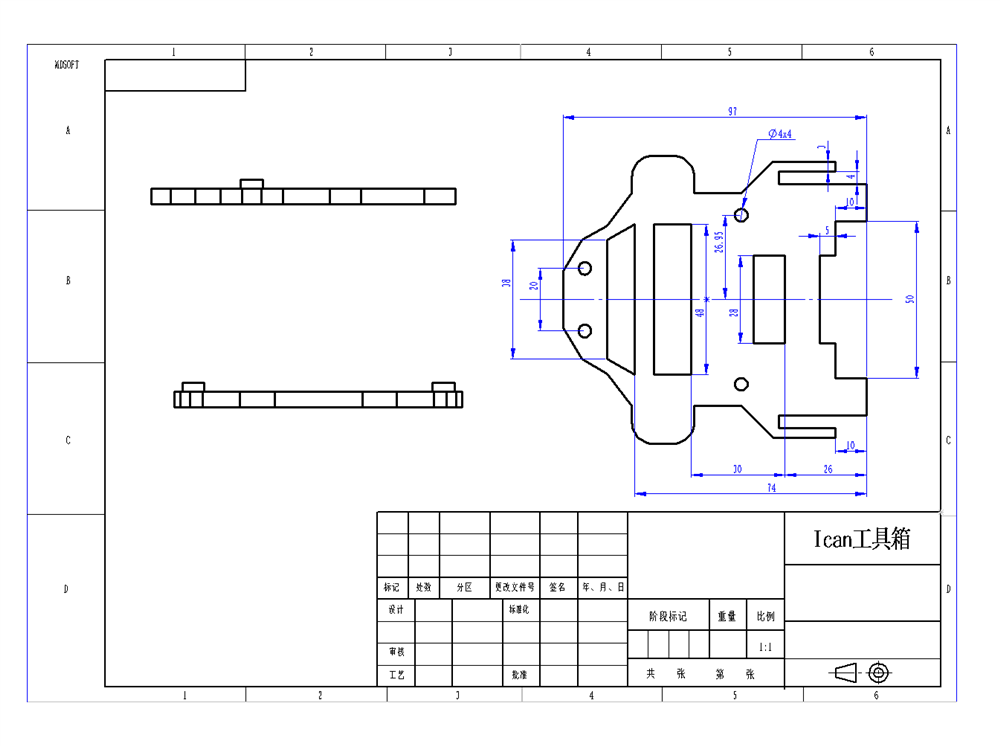

# 四足爬行机器人

> ✅ **已完成** — 建模、装配、工程图均已定稿，可直接打开复核。

一台四足步行机器人：**1 个机身 + 4 条相同的腿**。腿采用平行连杆结构，四条腿由同一个子装配体实例化四次，整机共 15 个零件。

**建模环境**：SOLIDWORKS 2026

---

## 预览

### 总装配体

### 子装配体

| 机身部分 | 运动部分（单腿） |
|---|---|
|  |  |

---

## 装配结构

| 层级 | 文件 | 顶层组件 | 说明 |
|---|---|---|---|
| 总装配 | `四足爬行机器人.SLDASM` | 5 | `机身部分-1`（固定）+ `运动部分-1 ~ -5`（四条腿） |
| 子装配 | `机身部分.SLDASM` | 12 | 承载板、支架与安装柱 |
| 子装配 | `运动部分.SLDASM` | 9 | 单条腿的连杆与关节件 |

> ⚠️ `四足爬行机器人.SLDASM` 中顶层组件为 **5 个**：1 个机身 + 4 个运动部分实例。
> 装配体依赖同目录下的零件文件，**请整目录克隆**，不要单独下载 `.SLDASM`。

---

## 零件清单

尺寸为 SolidWorks 提取的**实体包围盒**（单位 mm）。

### 机身部分用料

| 文件 | 尺寸 (mm) | 特征数 | 说明 |
|---|---|---|---|
| `零件1.SLDPRT` | 97 × 8 × 92 | 24 | 顶板，带平行长槽与 4 处安装柱 |
| `零件2.SLDPRT` | 85 × 8 × 91 | 23 | 底板，与零件1对合 |
| `零件6.SLDPRT` | 96 × 34 × 94 | 56 | 主体支架，镂空减重 |
| `零件15.SLDPRT` | 93 × 34 × 94 | 56 | 主体框架，含安装耳 |
| `零件4.SLDPRT` | 45 × 4 × 27 | 22 | 斜槽连接板（4 条斜向长槽） |
| `零件3.SLDPRT` | 30 × 10 × 17 | 30 | 关节座，带基准面与通孔 |
| `零件5.SLDPRT` | 12 × 17 × 8 | 25 | 小型挡块 / 垫块 |

### 运动部分用料（单腿 ×4）

| 文件 | 尺寸 (mm) | 特征数 | 说明 |
|---|---|---|---|
| `零件14.SLDPRT` | 133 × 18 × 26 | 28 | 小腿杆，末端分叉 |
| `零件9.SLDPRT` | 90 × 23 × 14 | 37 | 连杆 A |
| `零件10.SLDPRT` | 90 × 21 × 14 | 38 | 连杆 B（与 A 构成平行连杆） |
| `零件7.SLDPRT` | 66 × 19 × 21 | 37 | U 形关节夹 |
| `零件8.SLDPRT` | 66 × 21 × 25 | 46 | U 形关节夹（带凸耳） |
| `零件11.SLDPRT` | 61 × 5 × 38 | 25 | C 形连接板，带长槽 |
| `零件12.SLDPRT` | 18 × 20 × 20 | 25 | 双耳铰接座 |
| `零件13.SLDPRT` | 23 × 7 × 18 | 22 | 小型连接块 |

---

## 工程图

`engineering-drawing/零件1.SLDDRW` — 零件1 的二维工程图。

- 图框/标题栏由 **Ican 工具箱**生成（与零件属性中的"迈迪三维设计工具集"一致）
- 图幅比例 **1:1**，主要外形尺寸 97 / 74 / 50 mm
- 标注孔组 **2 × Ø4**
- 含主视图与两个向视图

---

## 建模与装配要点

1. **平行连杆腿**：零件9、零件10 两根连杆与零件7、零件8 两个 U 形夹构成平行四连杆，保证足端姿态在摆动中保持稳定——这是腿部设计的核心。
2. **减重设计**：零件6、零件15 主体支架采用大面积镂空，在保证刚度的同时降低质量。
3. **可复用子装配**：`运动部分.SLDASM` 设计为通用模块，四条腿通过四次实例化 + 不同配合位置安装，避免重复建模。
4. **自定义属性**：各零件带"设计软件 = 迈迪三维设计工具集"属性；装配体带国标标题栏属性模板（审定/设计/零件号/版本/图幅等）。

---

## 已知事项

- `.SLDASM` 只保存零件**引用关系**，不含几何。单独分享请用 **文件 → Pack and Go（打包）**。
- 各零件未指定材质，因此质量属性为空。
